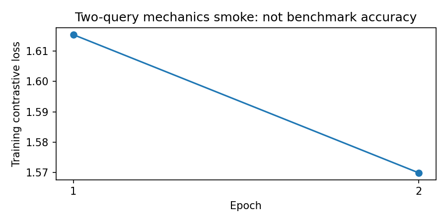

# Semantic Video Retriever

The current noncommercial research run attempts every adaptation-permitting source in the pinned DiDeMo metadata: 6,005 training, 825 validation and 762 test video candidates. There is no sampling cap. Download and decoder validation are in progress, so these are candidate counts rather than completed benchmark counts. See [research coverage](docs/full-research-coverage-amendment.json).

Find timestamped moments in real video using a natural-language description. A pinned CLIP image/text encoder supplies frozen features; contiguous five-second moments are ranked by cosine similarity. The current DiDeMo study trains a residual text adapter from real human descriptions and temporal references, with validation-only model selection.

Full-cohort training and evaluation are in progress. Historical subset experiments are not presented as full-dataset results; earlier test exposure will remain disclosed in the expanded evaluation.

## Run

Create a separate virtual environment for this repository. These projects share a package named `src`; installing them together is unsupported.

```powershell
python -m venv .venv
.\.venv\Scripts\Activate.ps1
python -m pip install -e ".[dev]"
python -m src.data.make_dataset
python -m src.models.train_model data/raw/big-buck-bunny.mp4
python -m src.models.predict_model "An animated bird singing on a tree branch"
python -m pytest -q
```

On Linux/macOS use `source .venv/bin/activate`. This small CC-BY movie demo builds an index with pretrained CLIP; `train_model` does not fine-tune it. The separate DiDeMo adapter study performs actual parameter training. The first CLIP download is approximately 605 MB.

```powershell
video-index path/to/licensed-video.mp4 --output data/processed/my-index --interval 2 --device cpu
video-search "person opening a door" --index data/processed/my-index --top-k 5 --suppress-seconds 4
```

Source hashes, model revision and numeric-array hashes are checked on load. Weight-loading defects raise errors rather than substituting random features. See [Report](Report.md) for the real-data training procedure and [data sources](docs/datasets.md) for licensing and attribution.

## Research data

```powershell
python -m src.data.didemo --noncommercial-research
python -m src.data.didemo --noncommercial-research --download
```

This study includes CC BY/BY-SA/BY-NC/BY-NC-SA 2.0 sources for noncommercial research. Preserve each source attribution and license. Media, captions, frame samples and trained weights remain private. NoDerivatives categories remain excluded; this is not all license categories of the official benchmark. The animation demo above is an installation check.

## Executed notebooks

- [Main workflow](notebooks/00_main_video_retrieval.ipynb): readable preparation, CLIP, temporal pooling, scorer, adapter, loss and training-loop code; actual source checks, two-query training replay and timestamp outputs from the saved checkpoint.
- [Real-source EDA](notebooks/01_real_source_eda.ipynb): measured source splits, description lengths, human-reference disagreement and temporal geometry.
- [Experiments and errors](notebooks/02_experiments_and_errors.ipynb): actual decoder failure, all-source audit, weight-loading and serialization evidence. Includes actual nine-fit learning curves and negative validation comparisons.



Optional encoding/training is disabled by default in notebooks. Executed public outputs contain aggregates and timestamp geometry, not private descriptions or media. Raw footage, captions and weights remain ignored.

- [Final evaluation](notebooks/03_final_evaluation.ipynb): executed identity checks and aggregate one-shot metrics, with validation/test cohort differences kept explicit.

## Data and limits

The current available DiDeMo subset has 364 training videos/1,390 queries, 73 validation videos/261 queries and 47 test videos. Test descriptions and target intervals are not staged for training. Availability filtering is substantial; this is not a reproduction of the full official benchmark. One training video declared six bins but lasted only 24.17 seconds. The first full job stopped before training or scoring; an audit of all 485 downloaded sources rejected that entire video before the corrected run.

Human reference intervals can disagree or admit no consensus-positive candidate. Custom corpus recall requires the correct video and temporal overlap; official within-video metrics are separate. Static averaged frames can miss temporal order, brief actions, small objects and negation. Exact-media split checks cannot rule out near duplicates, common creators or CLIP pretraining exposure.

The historical eight-query Sintel movie test is preserved in `models/heldout-evaluation.json`. It is an observed small demo test, not a fresh DiDeMo holdout or a basis for new model choices. Source files and indices use safe numeric-array loading; approximate timestamps on variable-frame-rate footage remain a limitation.
